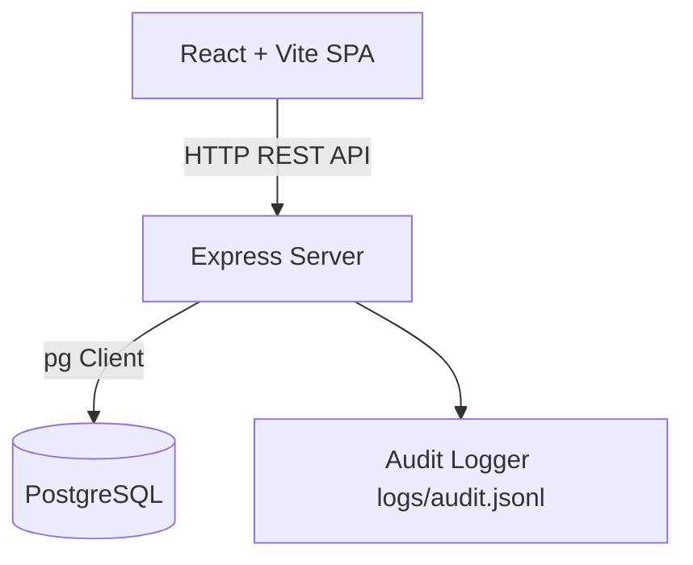

# Architecture Documentation

## System Architecture Overview

## Module Interfaces & I/O

### Server Modules

#### `server/src/domain/scoring.js`
- **Inputs:** `{ order: Order, dish: Dish, prices: MarketPrices, seed: number }`
- **Outputs:** `{ stars: number, breakdown: Breakdown, review: string }`

#### `server/src/db/migrate.js`
- **Inputs:** `DATABASE_URL: string`
- **Outputs:** `Promise<void>`

#### `server/src/controllers/dishes.controller.js`
- **`getOrder(req, res)`**
  - **Inputs:** `req.params.id`
  - **Outputs:** `200 { order, ingredients }` | `400/404/500 { error }`
- **`getDishes(req, res)`**
  - **Inputs:** None
  - **Outputs:** `200 { dishes: Array }` | `500 { error }`
- **`getDish(req, res)`**
  - **Inputs:** `req.params.id`
  - **Outputs:** `200 { dish }` | `400/404/500 { error }`
- **`postDish(req, res)`**
  - **Inputs:** `req.body { orderId: number, lines: Array<{ ingredientId: number, quantityG: number }>, seed?: number }`
  - **Outputs:** `201 { dishId, stars, review, breakdown, lines }` | `400/404/500 { error }`
- **`patchDish(req, res)`**
  - **Inputs:** `req.params.id`, `req.body { lines: Array<{ ingredientId: number, quantityG: number }> }`
  - **Outputs:** `200 { dishId, stars, review, breakdown, lines }` | `400/404/500 { error }`
- **`removeDish(req, res)`**
  - **Inputs:** `req.params.id`
  - **Outputs:** `204 No Content` | `400/404/500 { error }`

#### `server/src/repos/dishes.repo.js`
- **`createDish(orderId, lines, stars)`**
  - **Inputs:** `orderId: number`, `lines: Array<{ ingredientId: number, quantityG: number }>`, `stars: number`
  - **Outputs:** `Promise<{ id, orderId, kitchenId, stars, lines, createdAt }>`
- **`getAllDishes()`**
  - **Inputs:** None
  - **Outputs:** `Promise<Array<{ id, orderId, kitchenId, stars, lines, createdAt }>>`
- **`getDishById(dishId)`**
  - **Inputs:** `dishId: number`
  - **Outputs:** `Promise<{ id, orderId, kitchenId, stars, lines, createdAt } | null>`
- **`updateDish(dishId, lines, stars)`**
  - **Inputs:** `dishId: number`, `lines: Array<{ ingredientId: number, quantityG: number }>`, `stars: number`
  - **Outputs:** `Promise<{ id, orderId, kitchenId, stars, lines, createdAt } | null>`
- **`deleteDish(dishId)`**
  - **Inputs:** `dishId: number`
  - **Outputs:** `Promise<boolean>`

#### `server/src/utils/audit.js`
- **Inputs:** `{ action: string, details: object }`
- **Outputs:** `Promise<void>` (appends JSON line to `logs/audit.jsonl`)
