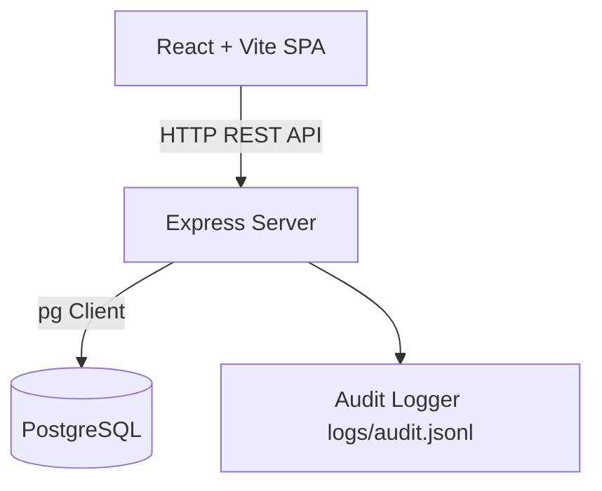

# Architecture Documentation

## System Architecture Overview

## Module Interfaces & I/O

### Server Modules

#### `server/src/domain/scoring.js`
- **Inputs:** `{ order: Order, dish: Dish, prices: MarketPrices, seed: number }`
- **Outputs:** `{ stars: number, breakdown: Breakdown, review: string }`

#### `server/src/db/migrate.js`
- **Inputs:** `DATABASE_URL: string`
- **Outputs:** `Promise<void>`

#### `server/src/utils/audit.js`
- **Inputs:** `{ action: string, details: object }`
- **Outputs:** `Promise<void>` (appends JSON line to `logs/audit.jsonl`)
