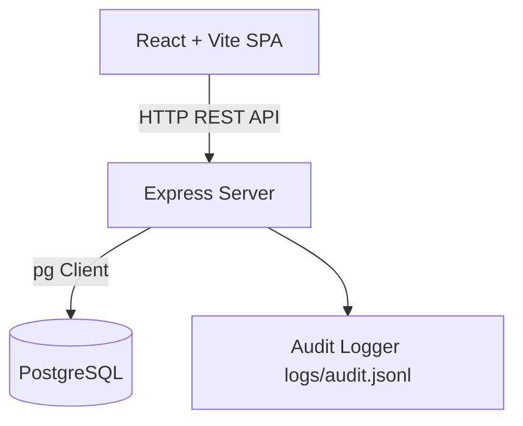

# Architecture Documentation

## System Architecture Overview

## Module Interfaces & I/O

### Server Modules

#### `server/src/domain/scoring.js`
- **Inputs:** `{ order: Order, dish: Dish, prices: MarketPrices, seed: number }`
- **Outputs:** `{ stars: number, breakdown: Breakdown, review: string }`

#### `server/src/domain/generator.js`
- **Inputs:** `{ kitchenTier?: number, seed?: number|string, ingredients?: Array }`
- **Outputs:** `{ customer: CustomerProfile, order: OrderSpec }`

#### `server/src/domain/review.js`
- **Inputs:** `{ breakdown: Breakdown, stars: number, favoriteName?: string, seed?: number|string }`
- **Outputs:** `reviewText: string`

#### `server/src/domain/progression.js`
- **`calculateXpForStars(stars)`**
  - **Inputs:** `stars: number`
  - **Outputs:** `xpGained: number`
- **`calculateTier(xp)`**
  - **Inputs:** `xp: number`
  - **Outputs:** `{ tier: number, name: string, xp: number, nextTierXp: number|null }`
- **`getTierName(tier)`**
  - **Inputs:** `tier: number`
  - **Outputs:** `name: string`

#### `server/src/db/migrate.js`
- **Inputs:** `DATABASE_URL: string`
- **Outputs:** `Promise<void>`

#### `server/src/controllers/ingredients.controller.js`
- **`listIngredients(req, res)`**
  - **Inputs:** `req.query { category?: string, sort?: 'price'|'protein', order?: 'asc'|'desc' }`
  - **Outputs:** `200 { ingredients: Array }` | `400/500 { error }`

#### `server/src/controllers/cosmetics.controller.js`
- **`getCosmetics(req, res, next)`**
  - **Inputs:** None
  - **Outputs:** `200 { cosmetics: Array }` | `500 { error }`
- **`handlePurchaseCosmetic(req, res, next)`**
  - **Inputs:** `req.params.id`
  - **Outputs:** `200 { message, cosmetic, wallet }` | `400/404/500 { error }`
- **`handleEquipCosmetic(req, res, next)`**
  - **Inputs:** `req.params.id`
  - **Outputs:** `200 { message, cosmeticId, type, equipped: true }` | `400/404/500 { error }`

#### `server/src/controllers/dishes.controller.js`
- **`getOrder(req, res)`**
  - **Inputs:** `req.params.id`
  - **Outputs:** `200 { order, ingredients }` | `400/404/500 { error }`
- **`getDishes(req, res)`**
  - **Inputs:** None
  - **Outputs:** `200 { dishes: Array }` | `500 { error }`
- **`getDish(req, res)`**
  - **Inputs:** `req.params.id`
  - **Outputs:** `200 { dish }` | `400/404/500 { error }`
- **`postDish(req, res)`**
  - **Inputs:** `req.body { orderId: number, lines: Array<{ ingredientId: number, quantityG: number }>, seed?: number }`
  - **Outputs:** `201 { dishId, stars, review, breakdown, lines, xpGained, kitchen }` | `400/404/500 { error }`
- **`patchDish(req, res)`**
  - **Inputs:** `req.params.id`, `req.body { lines: Array<{ ingredientId: number, quantityG: number }> }`
  - **Outputs:** `200 { dishId, stars, review, breakdown, lines }` | `400/404/500 { error }`
- **`removeDish(req, res)`**
  - **Inputs:** `req.params.id`
  - **Outputs:** `204 No Content` | `400/404/500 { error }`

#### `server/src/repos/cosmetics.repo.js`
- **`listCosmetics(kitchenId)`**
  - **Inputs:** `kitchenId?: number`
  - **Outputs:** `Promise<Array<{ id, name, type, price, unlockTier, value, description, unlocked, equipped }>>`
- **`purchaseCosmetic(kitchenId, cosmeticId)`**
  - **Inputs:** `kitchenId?: number`, `cosmeticId: number`
  - **Outputs:** `Promise<{ cosmetic, wallet, tier }>`
- **`equipCosmetic(kitchenId, cosmeticId)`**
  - **Inputs:** `kitchenId?: number`, `cosmeticId: number`
  - **Outputs:** `Promise<{ cosmeticId, type, equipped: true }>`

#### `server/src/repos/dishes.repo.js`
- **`createDish(orderId, lines, stars, reviewText, breakdown)`**
  - **Inputs:** `orderId: number`, `lines: Array<{ ingredientId: number, quantityG: number }>`, `stars: number`, `reviewText?: string`, `breakdown?: object`
  - **Outputs:** `Promise<{ id, orderId, kitchenId, stars, lines, createdAt, progression }>`
- **`getAllDishes()`**
  - **Inputs:** None
  - **Outputs:** `Promise<Array<{ id, orderId, kitchenId, stars, lines, createdAt }>>`
- **`getDishById(dishId)`**
  - **Inputs:** `dishId: number`
  - **Outputs:** `Promise<{ id, orderId, kitchenId, stars, lines, createdAt } | null>`
- **`updateDish(dishId, lines, stars, reviewText, breakdown)`**
  - **Inputs:** `dishId: number`, `lines: Array<{ ingredientId: number, quantityG: number }>`, `stars: number`, `reviewText?: string`, `breakdown?: object`
  - **Outputs:** `Promise<{ id, orderId, kitchenId, stars, lines, createdAt } | null>`
- **`deleteDish(dishId)`**
  - **Inputs:** `dishId: number`
  - **Outputs:** `Promise<boolean>`

#### `server/src/repos/orders.repo.js`
- **`getOrderById(orderId)`**
  - **Inputs:** `orderId: number`
  - **Outputs:** `Promise<{ id, kitchenId, customerId, customerName, job, diet, budget, targetProteinG, targetCarbsG, targetFatG, tolerancePct, favoriteIngredientId, blacklistedIngredientId, reviews: Array }> | null`
- **`createCustomerAndOrder({ kitchenId, customer, order })`**
  - **Inputs:** `{ kitchenId: number, customer: object, order: object }`
  - **Outputs:** `Promise<OrderObject>`

#### `server/src/utils/audit.js`
- **Inputs:** `{ action: string, details: object }`
- **Outputs:** `Promise<void>` (appends JSON line to `logs/audit.jsonl`)

### Client Page Components

#### `client/src/pages/DishPage.jsx`
- **Inputs:** URL route `/dishes/:dishId`
- **Outputs:** Renders Dish rating (stars), Customer review, Score breakdown, and Ingredients plating blueprint. Provides navigation back to `/orders`.

#### `client/src/pages/CosmeticsPage.jsx`
- **Inputs:** URL route `/cosmetics` or `/shop`, props `{ kitchen, onRefreshKitchen }`
- **Outputs:** Renders Cosmetics shop categories (themes, plate styles, badges), price/unlock tier requirements, and purchase/equip action controls.
